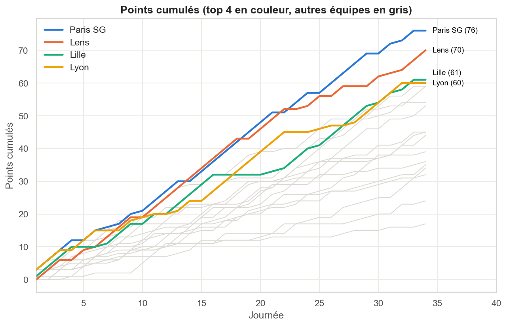

# ⚽ Ligue 1 — Web scraping, nettoyage et analyse de données

Projet réalisé en 1ʳᵉ année du cycle ingénieur : scraper les résultats de **tous les matchs** d'une saison de Ligue 1 et les classements de plus de dix saisons, contrôler la qualité des données, puis les analyser.

Source : [TheFootData](https://thefootdata.com/competitions/ligue-1?saison=2025), qui publie le classement et les résultats journée par journée depuis la saison 2014-15.



## Démarche

| Étape | Ce qui est fait |
|---|---|
| **Choix de la source** | FBref bloque les scripts (erreur 403 Cloudflare) et Wikipédia ne donne qu'un tableau de classement. TheFootData publie des pages HTML générées côté serveur avec les résultats de chaque journée. |
| **Scraping** | `requests` + `pandas.read_html` : le classement, puis les 34 journées (~306 matchs), puis le classement final de chaque saison depuis 2014-15. |
| **Scraping responsable** | Pause entre les requêtes, cache disque des pages, réutilisation des données brutes : une fois les données collectées, le notebook ne refait plus aucune requête. |
| **Nettoyage** | Noms de clubs officiels → noms courts, scores texte (`5 – 4`) → entiers, dates sans année (`dim 17 mai`) → vraies dates, forme (`VNVVD`) → points. |
| **Valeurs manquantes** | Les matchs sans score ne sont **pas imputés** (ce serait inventer un résultat) ; ils sont marqués `non joué` et exclus des calculs. |
| **Contrôle qualité** | Le classement est **recalculé à partir des 306 résultats** et comparé au classement publié, avec d'autres contrôles (doublons, 9 matchs par journée, chaque affiche jouée une fois à domicile…). |
| **Valeurs aberrantes** | Matchs à beaucoup de buts détectés par la règle de l'IQR, puis **conservés** car réels. |
| **Analyse** | Avantage du terrain, points à domicile et à l'extérieur, course au titre journée par journée, scores les plus fréquents, attaque/défense, évolution sur 10+ saisons. |

## Lancer le projet

```bash
git clone https://github.com/<mohamedazizameur-ai >/ligue1-scraping.git
cd ligue1-scraping
pip install -r requirements.txt
jupyter notebook ligue1_scraping_analysis.ipynb
```

- La **première exécution** scrape le site (environ 50 requêtes espacées de 3 secondes, donc 2 à 3 minutes). Les données brutes sont ensuite enregistrées dans `data/raw/` et réutilisées.
- Pour une autre saison : `SEASON = 2024` (saison 2024-25). Pour forcer un nouveau scraping : `REFRESH = True`.

### API (optionnel)
Le site propose une API à clé (`tfd_…`), pas encore ouverte au public d'après [sa documentation](https://thefootdata.com/api). Pour l'utiliser, copie `.env.example` en `.env` et renseigne ta clé et l'adresse de l'API. Le fichier `.env` est exclu du dépôt par `.gitignore` : **la clé n'est jamais publiée**.

## Structure

```
.
├── ligue1_scraping_analysis.ipynb   # notebook principal
├── data/
│   ├── raw/          # données brutes scrapées (CSV)
│   ├── processed/    # tables nettoyées
│   └── cache/        # pages HTML téléchargées (non publié)
├── figures/          # graphiques exportés
├── .env.example      # modèle pour la clé d'API
└── requirements.txt
```

## Technologies

Python · requests · pandas · lxml · matplotlib · seaborn

> Historique du projet : version initiale en R (`rvest`, `ggplot2`) sur FBref, puis passage à Python, à Wikipédia, et enfin à TheFootData pour disposer des données match par match.
